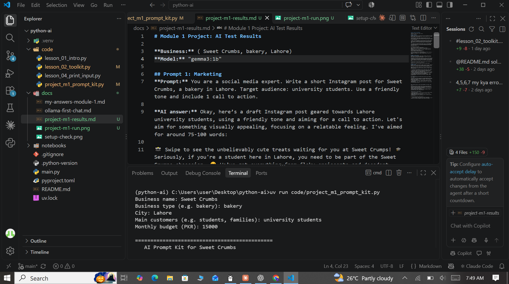
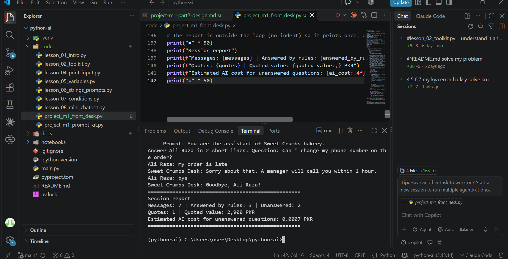

# Python AI

A small Python learning project focused on AI agent development and automation.

## About this project

This repository contains my beginner-to-intermediate exercises for learning:
 Python fundamentals
 AI tooling and environment setup
 Local model workflows with Ollama
 Agent-oriented development workflows in VS Code

## Course

AI for Everyone

## Personal goal

Become an AI Agent Developer and AI Automation Specialist.

## How to run

```bash
uv run main.py
```

## Lessons completed

 Lesson 01: Intro
 Lesson 02: Toolkit

## Current setup

 Python: 3.13
 Package manager: uv
 Editor: VS Code
 Local AI runtime: Ollama
## Module 1 Project: AI Prompt Kit

A Python tool that turns a local business's details into 3 ready-to-use AI prompts.

**Run:** `uv run code/project_m1_prompt_kit.py`



**Who would pay for this:** Small shop owners who want AI help but don't know what to type.


**Lesson 06 - Strings:** cleans a messy name and question, estimates characters, tokens and cost, checks for "python", and builds a safe multi-line prompt limited to 150 characters (`code/lesson_06_strings.py`)

**Lesson 07 - Conditions:** a router that sends private data to a local model, code questions to a strong model, and everything else to a cheap one, with a cost estimate and a long-request warning (`code/lesson_07_conditions.py`)

## Lesson 08 - Sweet Crumbs Bakery Bot

| # | Intent | Keywords | Reply |
|---|--------|----------|-------|
| 1 | Complaint (checked first) | late, wrong, cold, refund, complaint, delayed, bad, problem | Sorry about that. The manager will call you today. |
| 2 | Human handover | agent, human | Connecting you to a human... |
| 3 | Greeting | hi, hello, salam (start of message) | Hi! Ask about timings, prices, orders or delivery. |
| 4 | Timings | time, timing, timings, open, close | We are open 9 am to 9 pm, every day. |
| 5 | Price | price, cost, how much | Cakes start from 1,500 PKR per pound. |
| 6 | Order | order, cake, whatsapp | Please send flavour, weight and date. We need 1 day notice. |
| 7 | Delivery | delivery, deliver | We deliver within 5 km. Delivery charge is 200 PKR. |
| 8 | Fallback | anything else | Count it as unanswered and print the Module 2 AI prompt. |
## Project M1 Part 2: Sweet Crumbs Front Desk

A Python front desk for a bakery that answers common questions with rules, calculates exact price quotes, and prepares AI-ready prompts for everything else.

**Run:**
```
uv run code/project_m1_front_desk.py
```



**Value:** Saves the owner about 2 hours a day of answering the same WhatsApp questions and prevents price-quote mistakes, so the owner would pay for it because staff time and wrong quotes cost real money.